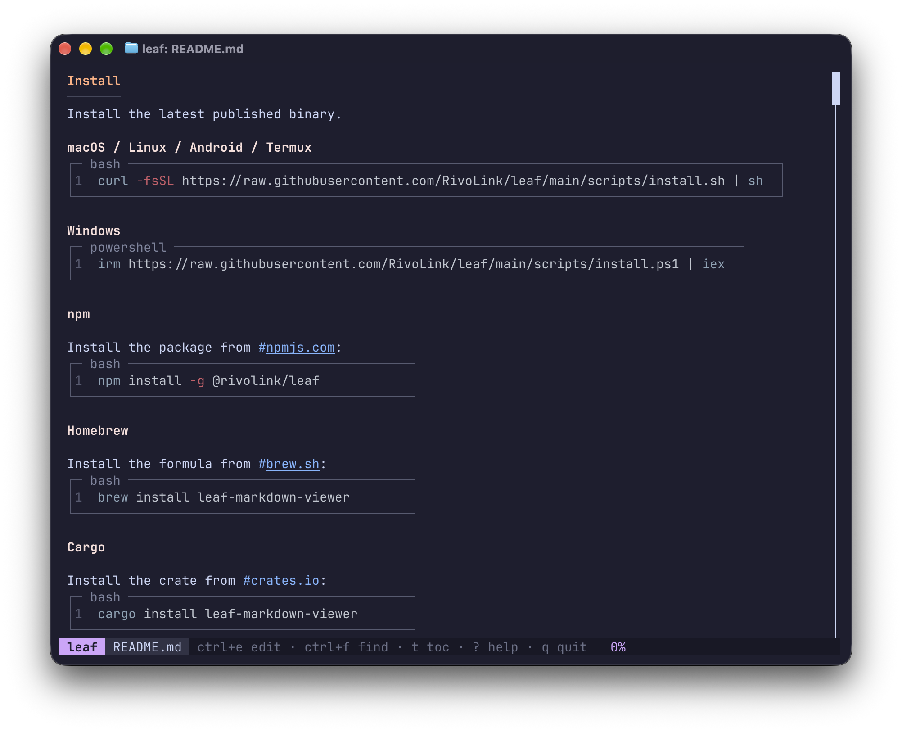

# Catppuchin for [leaf](https://github.com/RivoLink/leaf)

## Preview



## Installation

1. Download the TOML of your choice and move it into `~/.config/leaf/`
2. Add this line to your `~/.config/leaf/config.toml`

```toml
theme = "catppuccin-{FLAVOR}.toml"
```
